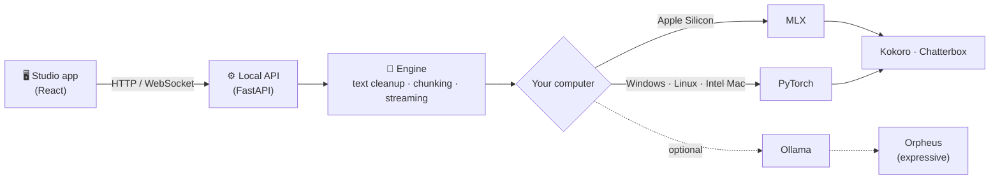

<div align="center">



<br>

**Turn scripts into natural narration and clone your own voice: unlimited, private, and free to run on your own computer.**

[](https://github.com/koppalanaveenkumar/bytewise-voice/actions/workflows/ci.yml)
[](LICENSE)
[](https://www.python.org/)
[](#-quick-start)
[](ROADMAP.md)

[Features](#-features) · [Quick start](#-quick-start) · [How it works](#-how-it-works) · [Roadmap](#-roadmap) · [Contributing](#-contributing)

</div>

---

> [!WARNING]
> **Early development.** The voice engine works; the studio app is being built. Star ⭐ or watch the repo to follow along.

## ✨ Why ByteWise Voice?

Cloud voice tools charge per character, upload every script and voice sample to their servers, and keep your voices locked inside their platform. ByteWise Voice runs **on your own machine** instead.

| | Cloud voice platforms | **ByteWise Voice** |
|---|---|---|
| 💸 **Cost** | Pay per character | **Unlimited.** Your computer does the work |
| 🔒 **Privacy** | Scripts and voices uploaded | **Never leaves your device** |
| 🧩 **Openness** | Closed source | **Open source.** Check every claim yourself |
| 📴 **Offline** | Needs internet | **Works offline** after the first model download |

## 🎙️ Features

| Feature | Status |
|---|---|
| Natural preset voices (Kokoro) | ✅ Working |
| Voice cloning from a short sample (Chatterbox) | 🧪 In testing |
| Runs on Windows (PyTorch engine) | ✅ Working |
| Runs on Apple Silicon Macs (MLX engine) | 🚧 In progress |
| Local API with built-in docs | ✅ Working |
| Studio app: paragraph editor, live waveform, projects | 🗺️ Planned |
| Streaming playback (audio starts in about 2 seconds) | 🗺️ Planned |
| Voice library with built-in consent | 🗺️ Planned |
| WAV / MP3 export | 🗺️ Planned |
| Expressive voices with emotion tags via [Ollama](https://ollama.com) | 🗺️ Planned |
| One-click desktop app for Mac and Windows | 🗺️ Planned |

### 🎧 Listen

*Demo clips are coming soon.*

## 🚀 Quick start

**You need:** Python 3.12 and Git.

<details open>
<summary><b>🪟 Windows (Git Bash) · 🐧 Linux · Intel Mac</b></summary>

```bash
git clone https://github.com/koppalanaveenkumar/bytewise-voice.git
cd bytewise-voice
py -3.12 -m venv venv              # macOS/Linux: python3.12 -m venv venv
source venv/Scripts/activate       # macOS/Linux: source venv/bin/activate
pip install -e ".[dev,torch]"      # installs PyTorch + Kokoro (about 1 GB)

python scripts/say.py "Hello! This is ByteWise Voice."
```

The first run downloads the Kokoro model (about 330 MB). Your audio is saved to `output/say.wav`.
</details>

<details>
<summary><b>🍎 Apple Silicon Mac (M1–M4)</b></summary>

The fast native MLX engine is in progress. Until then, use the PyTorch engine:

```bash
git clone https://github.com/koppalanaveenkumar/bytewise-voice.git
cd bytewise-voice
python3.12 -m venv venv
source venv/bin/activate
pip install -e ".[dev,torch]"

BYTEWISE_BACKEND=torch python scripts/say.py "Hello! This is ByteWise Voice."
```
</details>

<details>
<summary><b>🧪 Try it without downloading any AI models</b></summary>

The built-in **test engine** plays tones instead of speech. It's perfect for working on the app or running tests.

```bash
pip install -e ".[dev]"
BYTEWISE_BACKEND=fake uvicorn app.main:app --reload
```
</details>

### Run the API

```bash
uvicorn app.main:app --reload
```

Open **http://127.0.0.1:8000/docs** to explore the API in your browser.

### Try different voices

```bash
python scripts/say.py "Good morning, and welcome to the course." --voice bf_emma   # British
python scripts/say.py "Let's get started." --voice am_michael --speed 1.1           # American
```

## 🧠 How it works

ByteWise Voice doesn't train its own AI models. It builds a fast, private studio around the best **free, open-source voice models**, and picks the right engine for your computer automatically.



| Model | Used for | License |
|---|---|---|
| [Kokoro-82M](https://huggingface.co/hexgrad/Kokoro-82M) | Fast, natural preset voices | Apache-2.0 |
| [Chatterbox](https://github.com/resemble-ai/chatterbox) | Voice cloning from a short sample | MIT |

Everything runs on **127.0.0.1** only, so other devices and websites can't use your local engine.

## 🗺️ Roadmap

- [x] Cross-platform engine design and test engine
- [x] Kokoro preset voices on Windows
- [ ] Native Apple Silicon engine (MLX)
- [ ] Studio app with live waveform and paragraph editing
- [ ] Voice library and voice cloning with consent
- [ ] Desktop app for Mac and Windows
- [ ] Expressive voices with Ollama

📖 The full plan is in **[ROADMAP.md](ROADMAP.md)** (product) and **[DEVELOPMENT_PLAN.md](DEVELOPMENT_PLAN.md)** (architecture and tasks).

## 🤝 Contributing

Contributions are welcome! Please read **[CONTRIBUTING.md](CONTRIBUTING.md)** first. For bigger changes, open an issue to discuss the idea.

```bash
pip install -e ".[dev]"
pytest                          # tests use the test engine, no models needed
ruff check . && ruff format .
```

## 🛡️ Responsible use

Voice cloning is powerful. **Only clone a voice with that person's permission.** Don't use ByteWise Voice to impersonate, deceive or harass anyone. Audio generated with Chatterbox carries an inaudible watermark that identifies it as AI-generated.

## 📄 License

ByteWise Voice is licensed under the **[GNU AGPL-3.0](LICENSE)**. The AI models it uses have their own licenses: see **[THIRD_PARTY_LICENSES](THIRD_PARTY_LICENSES)**.

## 💙 Acknowledgements

Built on the shoulders of [Kokoro](https://huggingface.co/hexgrad/Kokoro-82M) by hexgrad, [Chatterbox](https://github.com/resemble-ai/chatterbox) by Resemble AI, [MLX](https://github.com/ml-explore/mlx) and [mlx-audio](https://github.com/Blaizzy/mlx-audio), [PyTorch](https://pytorch.org), and [FastAPI](https://fastapi.tiangolo.com).

<div align="center">
<br>
<sub>Made with care for creators who want their voice, their way.</sub>
</div>
